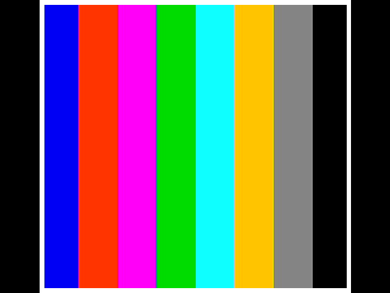

# F2 — DVI testna slika na ULX5M-GS + automatska provjera kadra (TASK-6069)

**Stanje:** gotovo · 11. 11. 2026. · grana `gatemate` · nastavak na F1 (`docs/F1.md`) ·
plan `regoc_system/docs/nes-gatemate/PLAN_NES_GATEMATE_20261111.md` („DVI prvi prikaz”, „Automatska provjera slike”).

Prva slika s ULX5M-GS kroz sloj platforme iz F1: NES-ov `vga.v` (s framebufferom i paletom),
protočni TMDS koder i serijalizator na 125 MHz kroz `CC_ODDR` + `CC_LVDS_OBUF`. Kadar se
snima HDMI snimačem na Piju i provjerava skriptom, bez čovjeka.



## Što je u repou

| datoteka | što |
|---|---|
| `platform/gatemate/gm_tmds_enc.v` | TMDS koder (DVI 1.0) u **3 stupnja**: q_m · broj jedinica · DC uravnoteženje; isti izlaz kao `tmds_encoder.v` |
| `platform/gatemate/gm_dvi_phy.v` | 10:1 serijalizacija na `clk_shift`: preklopka u domeni piksela → brid učita riječ, inače pomak za 2; `CC_ODDR` + `CC_LVDS_OBUF`; D1 kroz registar na padajući brid |
| `platform/gatemate/gm_dvi.v` | ulazni registar (izlazi `vga.v` su kombinacijski) + 3 × koder + PHY |
| `f2/f2_dvi_top.v` | top: `gm_clocks` + upisivač u NES ritmu (`clk_nes`, 341 × 262) → `vga.v` framebuffer → `gm_dvi` |
| `f2/f2_testpat.v` | testna slika u NES koordinatama: okvir 4 px (0x30) + 8 traka po 32 px |
| `f2/check_frame.py` | automatska provjera kadra → PASS/FAIL (+ JSON); `--exact` za kadar iz simulacije |
| `f2/test_check_frame.py` | 9 testova provjere (1 ispravan kadar + 8 krivih koje mora oboriti) |
| `f2/build.sh`, `f2/lab_f2.sh` | sinteza + P&R + `gmpack --reset`; učitavanje `fpga-jtag gs -r` + snimač + provjera |
| `sim/f2/` | `tb_tmds_enc.v`, `tb_f2_dvi.v`, `run_f2_sim.sh` |
| `docs/f2_logs/` | pnr.log, stat.txt, sha256, zapisi simulacije, laba (3 učitavanja), JSON provjere, kadrovi |

NES datoteke (`vga.v`, `framebuffer.v`, `tmds_encoder.v`, `vga2dvid.v`) **nisu mijenjane**.
F2 koristi `vga.v` doslovno, isti put kao u F4: PPU piše framebuffer u `clk_nes`, a `vga.v` ga čita u
`clk_pixel` s 2× skaliranjem i prozorom 65…575. U F2 je PPU zamijenjen generatorom `f2_testpat`.
`vga2dvid.v` je zamijenjen s `gm_dvi`: njegov 125 MHz dio (usporedbe `shift_clock`) bio je u F0
68–82 MHz, a kod GS-a se mora poštovati semantika `CC_ODDR`-a (vidi Nalaz 1).

## Put TMDS (LiteX_DVI „custom”, prilagođen)

```
vga.v (clk_pixel, kombinacijski) → registar → koder s1 → s2 → s3   [25 MHz, latencija 4]
  → tog (svaki takt piksela) ──► clk_shift: tog_d, ld = tog_d ^ tog
  → ld ? s ← riječ : s ← s >> 2                                    [125 MHz]
  → CC_ODDR D0 = s[0] (rastući), D1 = d1n (registar na padajući ← s[1])
  → CC_LVDS_OBUF → gpdi_dp/dn[0..2]  (0 = plavi + hsync/vsync, 1 = zeleni, 2 = crveni)
clk_pixel izravno → CC_LVDS_OBUF → gpdi_dp/dn[3]   (kao LiteX „custom”; CLK_SERIAL=1 = uzorak 0000011111 kroz ODDR)
```

Preklopka i registrirani brid (`ld`) su doslovni port `VideoCologneChipHDMI10to1Serializer`
iz `~/app/GateMate_demos/LiteX_DVI/gateware/video_colognechip_hdmi_phy.py`. Riječ se učita
2 takta od 125 MHz nakon brida piksela, a mijenja se tek 5 taktova kasnije. U 125 MHz domeni
nema druge logike osim pomaka i jednog XOR-a.

**Nalaz 1 — CC_ODDR hvata D1 na padajući brid.** U `cells_sim.v` je `q1 <= D1` na `negedge`, a
nextpnr to izvještava kao put posedge → negedge. Ako se D1 spoji izravno na registar pomaka, par
bitova je (S_n[0], S_n+1[1]), dakle iz susjednih riječi, i TMDS se raspada. LiteX to rješava
`CC_DFF`-om (rastući brid) ispred D1 (`litex/build/colognechip/common.py`,
`CologneChipDDROutputImpl`). Ovdje je D1 registar na **padajući** brid, s istim izlazom
(S_n[0], S_n[1]): ODDR na sljedećem padajućem bridu uzme njegovu staru vrijednost. Put fabric → IOSEL
postaje cijeli period umjesto pola. Prvi P&R s izravnim D1 dao je **123,82 MHz (FAIL)** na tom putu.
Mutacijski pokus (vidi Vrata 1) pokazuje da tb ovaj kvar hvata.

## Vrata 1 — simulacija (`sim/f2/run_f2_sim.sh`, iverilog iz oss-cad-suite-20261016)

**1a `tb_tmds_enc`: PASS 11 FAIL 0.** Uspoređuje `gm_tmds_enc` s NES-ovim `tmds_encoder.v`
(Mike Field), koji je referentni vektor, uz pomak latencije od 2 takta.
- 200 000 nasumičnih riječi (podaci, c, DE u naletima): **0 razlika**;
- dekodiranje DVI 1.0 vraća ulazni bajt: **0 grešaka**; najveća tekuća disparitet `|Σ(N1−5)|` = 4;
- 4 kontrolna simbola točna; crno (0x00) od cnt = 0 daje poznati slijed `0x100, 0x3FF, 0x100, 0x3FF`;
- mutacija (zamijenjen predznak cnt u grani „cnt = 0”) → **FAIL 4**, razlika 36 572, tb dakle hvata kvar.

**1b `tb_f2_dvi`: PASS 15 FAIL 0.** Simulira se cijeli `f2_dvi_top` s modelom `CC_PLL` iz F1 i
`CC_ODDR`/`CC_LVDS_OBUF` iz cells_sim. Pinovi se uzorkuju 2 ns nakon svakog brida `clk_shift`,
riječi se poravnaju na kontrolne simbole (faza 8), dekodiraju i mjere u riječima (= takt piksela):

| | izmjereno | 640×480@60 |
|---|---|---|
| H ukupno / DE / hsync / DE → pad hsync | 800 / 640 / 96 / 656 | 800 / 640 / 96 / 640+16 |
| V ukupno / aktivno / vsync / fp / bp (linija) | 525 / 480 / 2 (1600 riječi) / 10 / 33 | 525 / 480 / 2 / 10 / 33 |
| polaritet | hsync i vsync aktivni u 0, nikad hsync u DE | −hsync −vsync |
| takt kanala (pin `gpdi_dp[3]`) | 40 000,0 ps (847 817 perioda) | 25 MHz |
| dp = ~dn, poravnanje 3 kanala, G/R kontrola = 00 | 0 / 0 / 0 grešaka | — |

Okvir je 25 MHz / (800 × 525) = **59,52 Hz** (kao LiteX 640×480@60 s 25,000 MHz umjesto 25,175).

**1c Kadar iz simulacije.** Drugi VGA okvir, nakon što je upisivač ispunio framebuffer, dekodiran
je s pinova (`docs/f2_logs/snap/sim_tb_f2_frame.png`). `check_frame.py --exact` ga uspoređuje
piksel po piksel s očekivanom slikom (geometrija `vga.v` + paleta iz `vga.v`): **0 krivih od 307 200, PASS**.

**Mutacija PHY-a** (D1 izravno iz registra pomaka, bez `d1n`): MUTACIJA_REZULTAT

## Resursi i Fmax (nextpnr-himbaechel 0.11.1-63-g44a6c739, yosys 0.70+145, `fpga_mode=2`, `--freq 25`, seed 1)

| resurs | upotreba |
|---|---|
| CPE_LT / CPE_FF | 1 653 / 258 (od 40 960) |
| BRAM (`CC_BRAM_40K`) | 9 (RAM_HALF 18/64) — framebuffer 61 440 × 6 iz `vga.v` |
| PLL | 2 / 4 |
| CC_BUFG (globalne) | **3**: clk_shift, clk_pixel, clk_nes (USB djelitelj nekorišten → uklonjen) |
| CC_ODDR / CC_LVDS_OBUF | 3 / 4 |
| GPIO | 13 / 162 (8 LED + 4 LVDS para + clk25) |

| takt | Fmax nakon rutanja | cilj | |
|---|---|---|---|
| clk_shift | **128,24 MHz** | 125 | ✅ |
| clk_pixel | 31,03 MHz | 25 | ✅ |
| clk_nes | 36,46 MHz | 10,71 | ✅ |

Put do tablice (svaki korak je jedna promjena):

| korak | clk_shift | clk_pixel | uzrok |
|---|---|---|---|
| 1. koder u 2 stupnja, bez ulaznog registra, D1 izravno | 123,82 ❌ | 23,06 ❌ | D1 posedge→negedge do IOSEL (pola perioda); `vga.v` paleta + popcount + XOR + popcount u jednom taktu (43 ns) |
| 2. ulazni registar + koder u 3 stupnja | 123,82 ❌ | 30,81 ✅ | piksel riješen |
| 3. D1 kroz registar na padajući brid | **128,24 ✅** | 31,03 ✅ | put do IOSEL-a cijeli period |

Rezerva u 125 MHz domeni je mala: kritični put je fabric `s2[1]` → `d1n` (posedge → negedge),
3,90 ns od 4,00 ns. Ako u F4/F5 (puna NES jezgra) placer to pogorša, prvi pokus je drugi seed,
drugi je smještaj `d1n` uz pripadni registar pomaka. To ovdje nije rađeno, po pravilu jedne promjene.

## Vrata 2 — pločica (ULX5M-GS, gs DirtyJTAG E660583883501E2C) + snimač MS2109

Bit `build/f2/dvi/f2_dvi.bit`, sha256 `20996e17d8f578ae…` (`docs/f2_logs/sha256.txt`), CFGRST prisutan.
Naredba: `CTRL_BIT=build/f1/clkmeter/f1_clkmeter.bit f2/lab_f2.sh build/f2/dvi/f2_dvi.bit f2 3 f2_dvi`.
Svako od **3 učitavanja** ide samo kroz `fpga-jtag gs … -r` (SRAM), bez power-cyclea, uz zakup `/home/pi/gs.owner`:

1. **kontrola**: učita se F1 clkmeter (nema DVI-ja) → kadar **mora** biti „nema signala”;
2. učita se F2 → 6 s → 3 kadra `curl http://192.168.10.14:8090/snap.jpg` → `check_frame.py --spec f2`.

| učitavanje | kontrola (bez DVI-ja) | F2 kadrovi |
|---|---|---|
| 1 | 6609 B, svi pikseli 7 = NEMA SIGNALA ✅ | 3 / 3 PASS (22 297 B) |
| 2 | 6609 B, NEMA SIGNALA ✅ | 3 / 3 PASS |
| 3 | 6609 B, NEMA SIGNALA ✅ | 3 / 3 PASS |

Ukupno **9 / 9 PASS**. Svih 9 JPEG-ova je bajt po bajt jednako (md5 `3b36cfde…`), jer MS2109
kodira isti digitalni ulaz deterministički. Kontrola između učitavanja dokazuje da `snap.jpg` nije
zastarjeli okvir. Zapis: `docs/f2_logs/lab_3x.log`, `check_*.json`.

**Automatska provjera (`f2/check_frame.py`).** Očekivana slika gradi se iz istog opisa kao
`f2_testpat.v`, a boje iz tablice palete u `vga.v`. Provjerava se 14 područja: 2 crna ruba,
4 dijela okvira i 8 traka. Za svako se računa srednja boja unutrašnjosti (odmak 4 px, za okvir od 8 px 3 px).
Područje prolazi ako je ta boja (a) **najbliža svojoj** od svih očekivanih boja, (b) unutar ±64
po kanalu i (c) ako je std ≤ 24. Uniformna slika daje „nema signala”.
Izmjereno na GS-u (`check_1_1.json`):

| područje | očekivano (paleta) | snimljeno | |d| max | std |
|---|---|---|---|---|
| rubovi | 0,0,0 | 0,0,0 | 0 | 0 |
| okvir | 252,252,252 | 255,255,255 | 3 | ≤ 1 |
| 0x01 plavo | 0,0,252 | 0,0,244 | 8 | 0,6 |
| 0x16 crveno | 248,56,0 | 255,52,0 | 7 | 0,8 |
| 0x14 magenta | 216,0,204 | 255,0,248 | **44** | 2,0 |
| 0x19 zeleno | 0,184,0 | 0,220,0 | 36 | 0,4 |
| 0x3C cijan | 0,252,252 | 14,255,255 | 14 | 0,4 |
| 0x28 žuto | 248,184,0 | 255,196,0 | 12 | 1,0 |
| 0x00 sivo | 124,124,124 | 132,132,132 | 8 | 2,0 |
| 0x0F crno | 0,0,0 | 0,0,0 | 0 | 0,3 |

Snimač pojačava zasićenje (do +44), pa je glavni kriterij „najbliža boja”, a ±64 je samo gruba granica.
`f2/test_check_frame.py`: **9 pass, 0 fail**. Ispravan kadar prolazi, a padaju: bez signala, krivi spec,
zamijenjene trake, R↔B, pomak 40 px, šum 10 %, bez gornjeg okvira, pola crno.

**LiteX_DVI kao referenca snimača — nije dala sliku.** Prije našeg bita isprobana su tri LiteX bita:
`/home/pi/FPGA/ETH_GateMateA1_2509_1651_Linux_DVI_s1.bit` (27. 9. dao colorbars, memorija TASK-5074),
CPU-less colorbars iz TASK-5036 (`build_cb`, PLL `SPEED`, repack `gmpack --reset`) i isti netlist
ponovno P&R s PLL `ECONOMY` + `fpga_mode=2`. **Sva tri daju „svi pikseli 7” (nema signala)**, i nakon
restarta ffmpeg-a snimača (`lab_litex_cb_*.log`). Odmah zatim naš F2 bit daje ispravnu sliku na istom
kabelu i snimaču. Snimač je zato validiran kontrolom (bez DVI-ja → 7, F2 → slika), a ne LiteX-om.
Zašto stari LiteX bitovi danas ne daju sliku nije utvrđeno; nije potrebno za F2.
Hipoteza je da LiteX-ov serijalizator ima drugačiju fazu riječi ili da je u međuvremenu promijenjena ploča.

## Ponavljanje

```
sim/f2/run_f2_sim.sh                     # vrata 1 (≈ 6 min; 1b simulira ~49 ms)
python3 f2/test_check_frame.py           # testovi provjere kadra
f2/build.sh dvi                          # bit + Fmax
CTRL_BIT=build/f1/clkmeter/f1_clkmeter.bit f2/lab_f2.sh build/f2/dvi/f2_dvi.bit f2 3 f2_dvi   # vrata 2
```

## Za F3/F4

- `gm_dvi` je spreman za NES: `vga.v` izlazi idu izravno (top.v `G_dvi` → zamijeniti `vga2dvid` + `ODDRX1F` s `gm_dvi`).
- `check_frame.py` je općenit (spec = područja + boje); za F4 se dodaje spec PPU slike.
- Globalne mreže: F2 troši 3 (shift, pixel, nes); USB (lokalno) i SDRAM pin (ODDR) ne troše nove.
