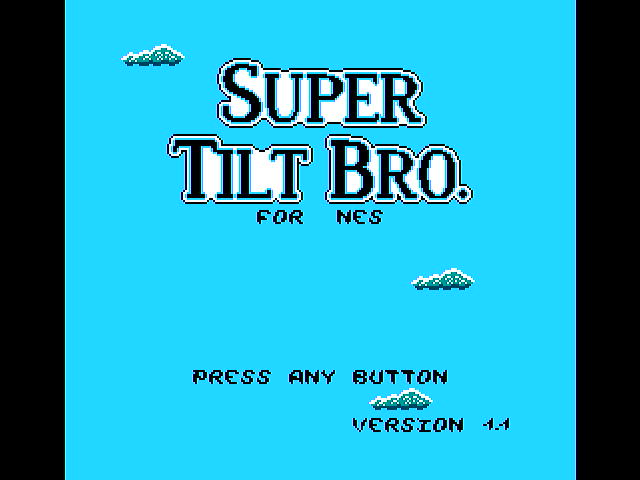
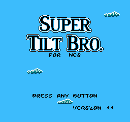
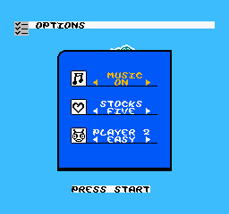

# F4 — cijeli NES (PPU + prva NROM igra) na ULX5M-GS, slika na DVI (TASK-6071)

**Stanje:** gotovo · 11. 11. 2026. · grana `gatemate` · plan `regoc_system/docs/nes-gatemate/PLAN_NES_GATEMATE_20261111.md`
(faza F4; „Do bitstreama za GS” #7, #8; „Usklađivanje taktova” C).

Cijela NES jezgra iz `nes.v` radi na GS-u: t65 (`t65/t65_ghdl.v`), PPU, APU (bez zvuka) i kartica samo za NROM.
Takt je `clk_nes` 10,714 MHz s djeliteljima CPU 6 / PPU 2 (opcija C). PRG, CHR, CPU RAM i VRAM su u BRAM-u,
a slika ide kroz `vga.v` → `gm_dvi` iz F2. Igra je **Super Tilt Bro** (`rom/game_tilt.nes`, NROM-256: 32 KB PRG
i 8 KB CHR, horizontalno zrcaljenje), koja je već u repou. Nema SDRAM-a (F6) ni USB-a (F5).



| vrata | rezultat |
|---|---|
| 1a nestest kroz cijeli `nes.v` | **8991 / 8991**, CRC `D4D52E3B` = `nestest.log`; trag uz 6/2 = trag uz 12/4 (`cmp` 0) |
| 1b kadrovi PPU-a prema emulatoru (cynes) | **115 / 115** nejednolikih kadrova (6–120) **piksel po piksel jednako**, 0 krivih piksela |
| 1c isto, uz tipku Start u kadrovima 60–69 | **191 / 191** kadrova (6–200) jednako, uključujući prijelaz u izbornik OPTIONS |
| 1d cijeli `f4_top` (model PLL-a, DVI, CRC, UART) | `tb_f4_top` **PASS 8 FAIL 0** |
| 1e netlist nakon `synth_gatemate` | CRC kadrova 1–8 = RTL (nakon popravka, v. Nalaz 1) |
| 2 pločica, 3 učitavanja `fpga-jtag gs -r` | kontrola bez DVI-ja 3/3 „nema signala”; **kadrovi 9 / 9 PASS**; **UART 36 / 36 redaka = simulacija** (CRC kadra) |
| Fmax `clk_nes` | **20,36 MHz** prema 10,71 (1,90 ×) |

## Što je u repou

| datoteka | što |
|---|---|
| `nes.v` | parametri `DIV_CPU`/`DIV_PPU` (zadano 12/4 = master) i `CART_NROM`; t65 `Abort_n`/`SO_n` = 1; `genie_ovr` = 0; `cpu_tick_count` = 0 (Nalaz 1); izlazi `dbg_*` (PC, Sync, NMI) |
| `ppu.sv` | 4 `wire` → `reg` (dodjela u `always`) i `sys_type` `inout` → `input`, da ga Verilator prevede; ponašanje isto |
| `f4/cart_nrom.v` | kartica samo za NROM s portovima `cart_top` (MMC0 + prevođenje adresa iz `cart_top`), bez 48 mappera |
| `f4/f4_nes_sys.v` | NES + PRG (16/32 KB), CPU RAM 2 KB, CHR 8 KB (ROM ili RAM), VRAM 2 KB u BRAM-u; džojped kao `top.v` |
| `f4/f4_frame_crc.v` | uzorkovač kadra: piksel = zadnja boja prije promjene položaja (kao framebuffer), CRC-32 po kadru; **isti modul u sim-u i u bitu** |
| `f4/f4_top.v` | top za GS: `gm_clocks` + NES + `vga`/`gm_dvi` + CRC + UART; tipke BTN1..3 = Start, A, Select |
| `f3/mkhex.py` | proširen: treći argument = CHR hex, ispis `mapper_flags` (oblik `game_loader.v`) |
| `f4/tilt_prg.hex`, `f4/tilt_chr.hex`, `f4/nestest_chr.hex` | `$readmemh` iz `rom/game_tilt.nes` i `f3/nestest.nes` |
| `f4/cmp_emu.py` | kadrovi iz simulacije prema emulatoru cynes, neovisno o paleti (v. niže) |
| `f4/frame2png.py`, `f4/render_vga.py`, `f4/mkref.py` | kadar → PNG; kadar → očekivani 640×480 izlaz `vga.v`; referenca za provjeru kadra |
| `f4/ref_tilt.txt` | referenca naslovnog ekrana: boja stalnih piksela (54 728 / 61 440), `--` za piksele koji se mijenjaju (oblaci) |
| `f2/check_frame.py --spec f4` | provjera kadra sa snimača prema referenci (v. niže); `f4/test_check_frame_f4.py` 11 testova |
| `f4/check_uart.py` | UART s pločice prema CRC-ovima kadrova iz simulacije |
| `f4/build.sh`, `f4/lab_f4.sh` | sinteza + P&R + `gmpack --reset`; 3 × (kontrola, `fpga-jtag gs -r`, UART, 3 kadra) |
| `sim/f4/` | `tb_f4_nestest.v`, `tb_f4_frame.v`, `tb_f4_top.v`, `run_f4_sim.sh` (sva vrata 1), `run_f4_gatesim.sh`, `run_f4_prepsim.sh` |
| `docs/f4_logs/` | pnr/stat/sha256, zapisi simulacija, laba (3 učitavanja), JSON provjera, kadrovi |

`cart.sv` (49 mappera, 53 % LUT4 NES-a prema F0) **nije u GateMate buildu**: `nes.v` uz `CART_NROM=1` uzima
`f4/cart_nrom.v`. ECP5 tok (`top.v`, Makefile) ostaje na zadanim vrijednostima (12/4, `cart_top`).

## Korak 1 — `nes.v` s djeliteljima 6/2 i `t65_ghdl.v` (regresija F3)

`sim/f4/tb_f4_nestest.v`: `f4_nes_sys` s nestest PRG-om i CHR-om, `RESET_PC=$C000`, trag kao u F3 (PC na `cpu_ce`
dohvata opkoda, registri na sljedećem `cpu_ce`, maska B-bita). Sada kroz **cijeli** NES: PPU, APU, DMA,
`cart_nrom`, BRAM.

| pokus | rezultat |
|---|---|
| DIV_CPU 6, DIV_PPU 2 | `PODUDARNO: 8991/8991`, `TRAG = REFERENCA`, CRC `D4D52E3B`, `$02=$03=00`, 26 563 CPU ciklusa, `los_razmak=0` |
| DIV_CPU 12, DIV_PPU 4 (master) | isto |
| trag 6/2 prema 12/4 (CYC od prvog retka) | `cmp` 0 |

iverilog ne prima `nes.v` (deklaracija nakon upotrebe, npr. `div_sys`), pa F4 simulira **Verilatorom 5.053**
iz istog oss-cad-suite-20261016. Simulacija je brza: 120 kadrova za ≈ 25 s.

## Korak 2 — kadar PPU-a iz NROM igre prema emulatoru

`sim/f4/tb_f4_frame.v` piše svaki kadar (61 440 boja 0..63, redom y, x) i CRC iz `f4_frame_crc`. Svaki kadar ima
**61 440 piksela** i **178 684 takta** (= 341 × 262 × 2), a svaki drugi 178 682 (preskočeni piksel neparnog kadra).
CPU dobije 29 780 / 29 781 ciklusa po kadru (= 89 342 / 3), OAM DMA 513 / 514, jedan NMI po kadru.

Sim kadar 120 (`f4_logs/sim/tilt_120.png`) i kadar 200 uz Start (`f4_logs/sim/start_200.png`, izbornik OPTIONS):

 

**Usporedba s emulatorom (`f4/cmp_emu.py`, cynes 0.1.2):** neovisna je o paleti. Za svaki naš indeks boje
uzima se najčešća RGB boja emulatora na istim pikselima. Krivi piksel je onaj koji od nje odstupa. Paleta
cynesa daje 0x20 i 0x30 kao istu bijelu, pa se obrnuti smjer ne broji. Jednolik kadar se ne broji kao dokaz.

| pokus | rezultat |
|---|---|
| kadrovi 6–120, `$0701=1` (v. Nalaz 2) | **115 ISTO, 0 krivih piksela** (`cmp_emu_poke.log`) |
| kadrovi 6–200, Start u kadrovima 60–69 | **191 ISTO, 0 krivih piksela** (`cmp_emu_start.log`) |
| kontrola: bez `$0701=1` | **100 od 115 kadrova RAZLIKA**, 37 002 kriva piksela (oblaci se miču drugim ritmom) → usporedba hvata razliku |
| slučajno početno stanje registara bez inita (`--x-initial unique`, 6 sjemena) | kadar 12 isti u 6 / 6 (`xr.log`) |

Faza pokretanja cynesa nije stalna: isti ROM u dva pokretanja daje promjene kadrova u 4, 5, 6, 9… ili u
5, 6, 7, 10…. Skripta zato bira jedan globalni pomak iz −2..2 na kadrovima prije pritiska tipke i
ispisuje ga (u zapisima: 0). Kontroler cynesa ima obrnuti redoslijed bitova prema `$4016` (bit 7 = A),
izmjereno: 0x08 (Up u cynesu) ne pomakne naslovni ekran, a svi ostali bitovi ga pomaknu.

**Nalaz 2 — igra mjeri NTSC/PAL pri pokretanju.** Super Tilt Bro (`$806E–$8081`) broji iteracije petlje
između dva vblanka. Ako je Y < `$40`, sustav je NTSC: upiše `$0701=1` i zatim čeka jedan kadar više u
svakih 6 (`$80FF`, logika na PAL tempu). Naš NES (NTSC tajming) daje `$0701=1`, jednako kao pločica (`V=01` na UART-u).
cynes na pokretanju dobije `$0701=0`, pa mu se oblaci miču u ritmu 8 umjesto 9,6 kadrova. S `$0701=1`
(`--poke 0x0701=1@3`) emulator i simulacija se poklapaju piksel po piksel. Razlika je dakle u pokretanju
emulatora, a ne u PPU-u. RAM nakon 22 kadra razlikovao se samo u 9 bajtova (brojači i `$0700/$0701`).

## Korak 3 — pločica (ULX5M-GS, gs DirtyJTAG E660583883501E2C) + snimač MS2109

Bit `build/f4/tilt_s3/f4_top.bit` (seed 3), sha256 `bf9ed688df0e6f67…` (`f4_logs/sha256.txt`), CFGRST prisutan.
Naredba: `f4/lab_f4.sh tilt_s3 3 16`. Svako od **3 učitavanja** ide samo kroz `fpga-jtag gs … -r` (SRAM), bez
power-cyclea, uz zakup `/home/pi/gs.owner`:

1. **kontrola**: F1 clkmeter (nema DVI-ja) → kadar **mora** biti „nema signala” (6609 B, svi pikseli 7);
2. F4 bit + UART 16 s → nakon 8 s 3 kadra `snap.jpg` → `check_frame.py --spec f4`.

| učitavanje | kontrola | kadrovi (`--spec f4`) | UART (`check_uart.py`) |
|---|---|---|---|
| 1 | NEMA SIGNALA ✅ | 3 / 3 PASS | 12 / 12 OK |
| 2 | NEMA SIGNALA ✅ | 3 / 3 PASS | 12 / 12 OK |
| 3 | NEMA SIGNALA ✅ | 3 / 3 PASS | 12 / 12 OK |

Svaki kadar: 584 jednolike pločice, 0 krivih; stalnih piksela 54 728, **podudarnost 0,9999** (prag 0,95).

UART jednom u sekundi (`f4/f4_top.v`):

```
F4 T=<redak> F=<kadar od reseta> H=<CRC kadra 120> G=<CRC zadnjeg kadra> N=<piksela> PC=<zadnji opkod> V=<$0701> I=<NMI/s> K=<tipke>
učitavanje 1: F4 T=0002 F=0075 H=00000000 G=63937DA4 N=0F000 PC=8119 V=01 I=3C K=7
              F4 T=0003 F=00B1 H=63937DA4 G=0D0717FF N=0F000 PC=811B V=01 I=3C K=7
              F4 T=000C F=02CD H=63937DA4 G=67519D4E N=0F000 PC=811B V=01 I=3C K=7
učitavanje 3: F4 T=0003 F=00AF H=63937DA4 G=0D0717FF N=0F000 PC=8119 V=01 I=3C K=7
```

`f4/check_uart.py` za svaki redak provjerava: **G = CRC kadra F iz simulacije** (`tb_f4_frame1000.log`, 1000 kadrova),
H = CRC kadra 120 iz simulacije (`63937DA4`), N = `0F000` (61 440), V = `01` (NTSC), K = 7 (tipke otpuštene,
PULLUP) i I = `3C` (60 NMI/s). U prvom retku je dopušteno `30..3D`, jer igra uključi NMI tek od kadra 5.
**UKUPNO: 36 OK, 0 razlika.** Kadar s pločice dakle nije samo „sličan”: CRC svih 61 440 piksela jednak je
simulaciji za svaki ispisani kadar (F = 55…775), a simulacija je jednaka emulatoru.

**Provjera kadra `--spec f4`.** Referenca je `f4/ref_tilt.txt` (`f4/mkref.py` nad kadrovima 7–1000), a provjerava se
samo stalni dio slike. Oblaci se miču i preskaču. (a) Jednolike pločice 8 × 8 NES piksela (16 × 16 na VGA, odmak
4 px): srednja boja mora biti najbliža svojoj od boja reference, unutar ±64, uz std ≤ 24. (b) Svi stalni pikseli
(sredina 2 × 2 VGA) moraju imati najbližu boju jednaku referenci u ≥ 95 %. Crni rubovi su kao u F2.
`f4/test_check_frame_f4.py`: **11 pass, 0 fail**. Ispravan kadar prolazi, a padaju: bez signala, F2 testna slika,
stvarni kvar (CPU zapeo, crn kadar, Nalaz 1), pomak 8 px vodoravno i okomito, R↔B, šum 10 %, pola crno,
bez natpisa i sivo. `f2/test_check_frame.py` i dalje 9 / 9.

**Tipke.** BTN1 = Start, BTN2 = A, BTN3 = Select (aktivne u 0, PULLUP). Na pločici je izmjeren samo otpušten
položaj (`K=7` u svih 36 redaka). Pritisak nije izmjeren, jer bez čovjeka nema tko pritisnuti. Put tipke kroz
džojped je dokazan u simulaciji: Start u kadrovima 60–69 daje 191 / 191 kadrova jednako emulatoru.

## Nalaz 1 — `cpu_tick_count` bez inita: CPU na pločici zapne na `$2002`

Prvi bit (`build/f4/tilt_prije_fixa`) je na pločici davao 60 kadrova u sekundi s 61 440 piksela, ali crnu sliku.
UART je pokazivao `PC=804E`, `V=00`, `I=00`, a `G` je stalno bio `D4AB8819` (kadar prije uključenja slike):
CPU je vrtio `BIT $2002 / BPL` i čekao vblank koji nikad nije vidio. RTL simulacija to nije pokazivala.

Bisekcija **simulacijom netlista** (`sim/f4/run_f4_prepsim.sh`, `run_f4_gatesim.sh`):

| netlist | kadar 4 |
|---|---|
| RTL / `prep -flatten` | PC `811B`, kadrovi 5–8 = RTL |
| `synth_gatemate` / `synth -flatten` | PC `804B` = **zapeo kao pločica** |
| `synth -run :fine` (coarse) | `811B` |
| + `opt -fast -full; memory_map; opt -full` | `811B` |
| + `techmap` | `811B` |
| + `techmap; opt -fast` | `804B` |

Nakon `opt -fast` netlist ima `assign nes.cpu_tick_count = 3'hx`. Registar je bez početne vrijednosti, a
za NTSC (`sys_type=0`) nikad se ne piše (samo PAL ga broji), pa ga yosys smije zamijeniti bilo čime. Na njemu
vise `cart_pre`, `ppu_read`, `ppu_write` i `skip_ppu_cycle`. Kad se x razriješi nedosljedno, čitanje `$2002`
promaši. Slučajno početno stanje u RTL-u (sjeme 4) pokazalo je i drugi oblik istog kvara: s
`cpu_tick_count=4` CPU dobije samo 22 336 ciklusa po kadru. **Popravak (jedna promjena):**
`reg [2:0] cpu_tick_count = 3'd0;` u `nes.v`. Nakon njega `synth_gatemate` netlist daje kadrove 1–8 jednake RTL-u,
slučajno početno stanje daje 6 / 6 isti kadar, a pločica prikazuje igru. Zapis: `f4_logs/gatesim_prije.log`, `gatesim_poslije.log`.

Ista zamka postoji u ECP5 toku (master), ali tamo očito nije okinula. Kandidati iste vrste u `nes.v`:
`faux_pixel_cnt` (bez inita, ali se piše) i `last_sys_type`/`div_*` (imaju init).

## Fmax i resursi (nextpnr-himbaechel 0.11.1-63-g44a6c739, yosys 0.70+145, `fpga_mode=2` ECONOMY, `--freq 25`)

| takt | cilj | seed 1 | seed 2 | **seed 3 (bit)** | rezerva (seed 3) |
|---|---|---|---|---|---|
| `clk_nes` | 10,71 | 19,23 | 20,61 | **20,36** | **1,90 ×** ✅ |
| `clk_pixel` | 25,00 | 27,61 | 23,75 ❌ | **28,08** | 1,12 × ✅ |
| `clk_shift` | 125,00 | 121,39 ❌ | 158,23 | **157,55** | 1,26 × ✅ |

Prvi bit prije popravka (seed 1) imao je `clk_nes` 18,01 i `clk_shift` 153,54 MHz. Sa seedom 1 nakon popravka
`clk_shift` pada na put `d1n` (F2 je to najavio). Prvi pokus prema F2 je bio drugi seed. Seed 3 prolazi
sve, pa je to bit za pločicu. Rezerva `clk_pixel` je mala (1,12 ×) i ovisna o smještaju, a `clk_shift` ovisi o seedu:
za F5 vrijedi ili zadržati seed 3, ili dodati ograničenje smještaja `d1n` (F2 drugi pokus). Kritični put `clk_nes`:
12,82 ns logike i 36,31 ns rutanja (t65 → sabirnica). CPU uzima podatak tek svaki 6. takt, pa je rezerva veća nego što
pokazuje Fmax.

| resurs | F4 (cijeli bit) | napomena |
|---|---|---|
| CPE_LT | **8 299 / 40 960 (20 %)** | F0 s `cart_top`: 20 880 (51 %); rez mappera + bez USB-a |
| CPE_FF | 2 220 / 40 960 (5 %) | |
| RAM_HALF | **38 / 64** (16 × `CC_BRAM_20K` + 11 × `CC_BRAM_40K`) | framebuffer 18 (F2) + PRG 32 KB 14 + CHR 8 KB 4 + CPU RAM 1 + VRAM 1 |
| PLL | 2 / 4 | `gm_clocks` |
| CC_BUFG | 3 / 4 | clk_shift, clk_pixel, clk_nes (jedna u rezervi za USB u F5) |
| CC_ODDR / GPIO | 3 / 18 | 4 LVDS para + LED + UART + tipke + clk25 |

## Ponavljanje

```
sim/f4/run_f4_sim.sh                     # vrata 1a–1e (≈ 25 min; CYNES_PY = ~/app/tmp/tools/nes-cynes/venv/bin/python)
python3 f4/test_check_frame_f4.py        # 11 testova provjere kadra
SEED=3 f4/build.sh tilt_s3               # bit + Fmax
f4/lab_f4.sh tilt_s3 3 16                # vrata 2 (3 učitavanja; treba build/f4/sim/tb_f4_frame1000.log iz sim-a)
```

Okolina za emulator: `~/app/tmp/tools/nes-cynes` (venv, `requirements.txt`, upisano u katalog alata).

## Za F5

- `clk_usb` iz `gm_clocks` (125 / 21, lokalno rutanje) je već tu; `usbh_host_hid` + dekoder → `buttons` u `f4_nes_sys`
  (OR s tipkama GS-a). Globalne mreže: 3 / 4 zauzete.
- Prije spajanja USB-a: provjeriti `clk_shift`/`clk_pixel` uz novu logiku (seed ili ograničenje smještaja `d1n`).
- `f4_frame_crc` + `check_uart.py` služe i za F5: pritisak s gamepada mora dati isti slijed CRC-ova kao `tb_f4_frame` s `BUTTONS`.
