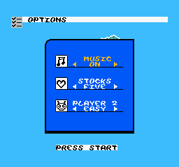

# F5 — USB tipkovnica / gamepad → tipke NES-a na ULX5M-GS (TASK-6072)

**Stanje:** sim ✅ · bit ✅ · pločica bez čovjeka ✅ · **pritisak na pločici čeka Gorana** (dio B laba radi) ·
11. 11. 2026. · grana `gatemate` · plan `regoc_system/docs/nes-gatemate/PLAN_NES_GATEMATE_20261111.md` (faza F5;
„Usklađivanje taktova” E).

Emardov USB 1.1 HID host (`usbh_host_hid`) radi na `clk_usb` = 125 / 21 = **5,952 MHz** (low speed, −0,79 %, LS
dopušta ±1,5 %) iz `gm_clocks`, na **lokalnom rutanju**: nema PLL-a ni 4. globalne mreže (CC_BUFG ostaje **3 / 4**).
Izvještaj ide kroz dekoder i CDC u `clk_nes`, pa se OR-a s tipkama GS-a u `f4_nes_sys.buttons`. Pinovi su USB-C J5:
D+ `IO_EA_A0`, D− `IO_EA_B0`, pull `IO_EA_A2`/`IO_EA_B2` = 0 (host pull-down), iz `platform/gatemate/ulx5m_gs.ccf`
(F1, isto kao `litex-eth-ulx5m-gs-1g-sbc gateware/usb_hid.py`).

| vrata | rezultat |
|---|---|
| 1a HID izvještaj → tipke (`tb_f5_decoder`) | **PASS 20 FAIL 0**: tipkovnica 10 slučajeva, Emardov NES džojstik 4, `active` (Nalaz 1) 5, bez `valid` 1 |
| 1b tipka iz HID izvještaja kroz CDC u `f4_nes_sys` | tipkovnica **Enter** i džojstik **Start**: CRC kadrova 1–200 **= F4 2b** (`tb_f4_frame` BUTTONS 08 u kadrovima 60–69), `cmp` 0 |
| 1c kontrola: tipka „a” (nije mapirana) | ≠ F4 2b od kadra 72, = kadrovi bez tipke (`cmp` 0) → usporedba hvata krivu tipku |
| 1d cijeli `f5_top` (model PLL-a, host, UART) | bez uređaja **PASS 20 FAIL 0**; s LS pull-upom na D− **PASS 20 FAIL 0** (host vidi J i ulazi u SETUP, L=67) |
| 1e `f5_top`, slučajno početno stanje (6 sjemena) | **6 / 6 PASS 20 FAIL 0**; prije popravka Nalaza 1: **3 / 4 sjemena lažni izvještaj** |
| 2 bit, seed 1 | CPE_LT **10 322 (25 %)**, CC_BUFG **3 / 4**, `clk_usb` 44,45 MHz prema 5,95 (7,5 ×), sve domene PASS |
| 3A pločica bez čovjeka, 3 učitavanja `fpga-jtag gs -r` | kontrola 3/3 „nema signala”; **kadrovi 9 / 9 PASS**; **UART 36 / 36 = sim**, `--bez-tipke` (nema lažne tipke) |
| 3B pločica: Enter na J5 → izbornik OPTIONS | **čeka pritisak**: 1. pokušaj istekao bez uređaja (11. 11. 23:40 → 12. 11. 02:40, L = 40 cijelo vrijeme); lab ponovno čeka od 12. 11. 02:42 do 16:42 |

## Što je u repou

| datoteka | što |
|---|---|
| `f5/f5_top.v` | `f4_top` + `f5_usb_joy`; tipke = GS \| USB; UART redak `F5 … K= J= U= R= L=`; LED6 = uređaj enumeriran |
| `f5/f5_usb_joy.v` | `usbh_host_hid` (LS, 8 B, `strict=0`, setup ROM `usb/usbhost/usbh_setup_rom.mem`) + `f5_hid_buttons` + dijagnostika za UART (CDC) |
| `f5/f5_hid_buttons.v` | dekoder (USB domena) + CDC u `clk_nes` (2 FF + prihvat tek kad su dva uzorka jednaka) + maska `active` (Nalaz 1); **isti modul u sim-u i u bitu** |
| `f5/f5_report_decoder_kbd.v` | USB boot tipkovnica → NES (tablica niže) |
| `usb/report_decoder/usbh_report_decoder_nes.v` | Emardov NES USB džojstik (`DECODER=1`), nepromijenjen |
| `f5/usbhost/` | `usbh_sie.v` i `usb_phy_ghdl.v` iz `litex-eth-ulx5m-gs-1g-sbc` @e4b4b4b (README): ista kombinacija koja na GS-u radi s tipkovnicom |
| `f4/check_uart.py` | prima i F5 redak; `--bez-tipke` (J ≠ 00 = greška), `--usb-enum` (bar jedan redak s L[1:0] = 2); izlaz 1 ako nijedan redak nije provjeren. F4 izlaz nad F4 zapisima je bajt-jednak |
| `f5/ref_options.txt` | referenca izbornika OPTIONS (`f4/mkref.py`, sim Start u 60–69, kadrovi 150–400, 61 192 stalna piksela) |
| `f5/build.sh`, `f5/lab_f5.sh`, `f5/lab_f5_tipka.sh` | bit; dio A (3 × kontrola + bit + UART + 3 kadra); dio B (čeka pritisak, kadrovi prije/poslije) |
| `sim/f5/` | `tb_f5_decoder.v`, `tb_f5_frame.v`, `tb_f5_top.v`, `run_f5_sim.sh` (vrata 1a–1e, ≈ 12 min) |
| `docs/f5_logs/` | zapisi simulacije, Fmax po seedu, pnr/stat/sha256, lab A, UART prije popravka |

## Tipke

Izlaz je `{Right, Left, Down, Up, Start, Select, B, A}` (aktivno u 1, redoslijed čitanja `$4016`).

| NES | tipkovnica (`DECODER=0`, zadano) | NES USB džojstik (`DECODER=1`) | GS |
|---|---|---|---|
| križ | strelice (0x4F–0x52) | bajt 3 / 4 bitovi 7:6 | – |
| Start | Enter (0x28), keypad Enter (0x58) | bajt 6 bit 5 | BTN1 |
| Select | Space (0x2C), Tab (0x2B), desni Shift | bajt 6 bit 4 | BTN3 |
| A | X (0x1B), lijevi Ctrl | bajt 5 bit 5 | BTN2 |
| B | Z (0x1D), lijevi Alt | bajt 5 bit 4 | – |

Zadana je tipkovnica jer je to uređaj koji na GS-u već radi (LiteX, Goran 11. 11.). Za drugi gamepad UART pokazuje
sirovi izvještaj (`R=`, bajt 7…0) i broj izvještaja (`U=`), pa se dekoder piše prema stvarnom izvještaju.
Ako je uređaj full speed (48 MHz), ovaj PHY ga ne može pokrenuti: treba `usb/usb11_phy_vhdl/` + `C_usb_speed=1` + takt 48 MHz.

UART jednom u sekundi:

```
F5 T=<redak> F=<kadar> H=<CRC kadra 120> G=<CRC zadnjeg kadra> N=<piksela> PC=<opkod> V=<$0701> I=<NMI/s> K=<tipke GS-a>
   J=<tipke NES-a (USB | GS), OR kroz zadnju sekundu> U=<broj HID izvještaja> R=<zadnji izvještaj> L=<LED hosta>
L = {reset_pending, txover, setup_acked[3], LINESTATE[1:0], R_state[1:0]};  R_state: 0 DETACHED, 1 SETUP, 2 REPORT, 3 DATA
```

## Korak 1 — simulacija (`sim/f5/run_f5_sim.sh`, Verilator 5.053)

**1b** je traženi dokaz: `tb_f5_frame` šalje izvještaj u USB domeni (5,952 MHz, impuls `hid_valid` jedan takt, kao host)
na kraju kadra 59 (pritisak) i 69 (otpuštanje), a tipke u `f4_nes_sys` dolaze kroz `f5_hid_buttons`. Kašnjenje
izvještaj → tipka je **7 taktova `clk_nes`** (otpuštanje 6). CRC svih 200 kadrova jednak je `tb_f4_frame` s
`BUTTONS=08` u kadrovima 60–69, a ta je simulacija u F4 bila jednaka emulatoru (191 / 191). Isto vrijedi za Enter s
tipkovnice i Start s Emardovog džojstika. Prijelaz u izbornik OPTIONS:



**1d / DEV=1** pokazuje da host na modelu `gm_clocks` (125 / 21) radi: uz pull-up na D− (LS uređaj) LINESTATE postaje J
i stanje ide DETACHED → SETUP/DATA (L = 0x67). Sam uređaj nije modeliran, pa enumeraciju dokazuje tek pločica (3B).

## Nalaz 1 — lažni HID izvještaj nakon konfiguracije: A + B + Select stalno pritisnuti

Prvi bit (`build/f5/prije_nalaza1/kbd_s1`) je na pločici, bez ikakvog uređaja na J5 (L = 40: DETACHED, SE0), u svakom
od 3 učitavanja javio **jedan izvještaj `R=FFFFFFFFFFFFFFFF`, `U=0001`**. Dekoder tipkovnice čita bajt 0 = 0xFF kao
modifikatore: lijevi Ctrl = A, lijevi Alt = B, desni Shift = Select, pa je **J=07 stalno**. Slika je i dalje prolazila
provjeru naslova (igra traži novi pritisak), ali je CRC kadrova odstupao od simulacije
(`f5_logs/lab/check_uart_prije_nalaza1.log`: 0 OK, 37 razlika).

Uzrok: `usbh_host_hid` ima registre bez početne vrijednosti (`R_hid_valid`, `R_report_buf`, `R_rx_done`…). Nakon
konfiguracije jedan impuls `hid_valid` prođe dok host još nije ni vidio uređaj. RTL simulacija (Verilator inicijalizira
nulama) to ne pokazuje. **Reproducirano** u `tb_f5_top` uz `--x-initial unique`: 3 od 4 sjemena daju lažni izvještaj
(`f5_logs/sim/xr_prije_popravka.log`).

**Popravak (u omotaču, Emardov kod se ne dira):** izvještaj vrijedi samo kad je host u stanju REPORT (`led[1:0] = 2`)
i izvan reseta (`active`). Tipke su 0 dok ne stigne prvi valjani izvještaj u tom razdoblju (`got`), što pokriva i Emardov
dekoder bez inita. Isto vrijedi pri odspajanju: host ide u DETACHED, pa se tipke otpuste. Nakon popravka 1e daje 6 / 6
sjemena PASS, a pločica 36 / 36 redaka uz `--bez-tipke`. REPORT je izlazno stanje samo prema DETACHED
(`usbh_host_hid.v` 522–571), pa maska ne reže pritiske tijekom rada.

Ista zamka postoji u ECP5 toku (`top.v`), ali se tamo lažna tipka vjerojatno nije vidjela ili nije smetala.

## Korak 2 — bit (oss-cad-suite-20261016, `fpga_mode=2` ECONOMY, `--freq 25`)

| takt | cilj | seed 1 (**bit**) | seed 2 | seed 3 | rezerva seed 1 |
|---|---|---|---|---|---|
| `clk_nes` | 10,71 | **18,59** | 20,31 | 17,85 | 1,74 × |
| `clk_pixel` | 25,00 | **27,55** | 28,34 | 29,14 | 1,10 × |
| `clk_shift` | 125,00 | **136,20** | 133,80 | 131,23 | 1,09 × |
| `clk_usb` (`u_usbdiv.q`) | 5,95 | **44,45** | 45,89 | 44,14 | 7,5 × |

Sva tri seeda prolaze. Bit je seed 1, jer ima najveću najmanju rezervu. Prvi bit (prije Nalaza 1) je sa seedom 3
imao `clk_shift` **117,54 ❌** (F4: `clk_shift` ovisi o seedu), pa se seed bira po buildu.

| resurs | F5 | F4 | razlika |
|---|---|---|---|
| CPE_LT | **10 322 / 40 960 (25 %)** | 8 299 | +2 023 (USB host + SIE + PHY + dekoder + UART) |
| CPE_FF | 3 305 (8 %) | 2 220 | +1 085 |
| RAM_HALF | 38 / 64 | 38 | 0 |
| CC_BUFG | **3 / 4** | 3 | 0: `clk_usb` je lokalni (`clkbuf_inhibit` u `gm_clkdiv`) |
| PLL | 2 / 4 | 2 | 0 |
| GPIO | 22 | 18 | +4: `IO_EA_A0`/`B0` (CC_IOBUF, D+/D−), `IO_EA_A2`/`B2` (pull = 0) |

Bit: `build/f5/kbd_s1/f5_top.bit`, sha256 `445e687d3b32b6de…` (`f5_logs/sha256.txt`), CFGRST prisutan.

## Korak 3A — pločica bez čovjeka (`f5/lab_f5.sh kbd_s1 3 16`)

| učitavanje | kontrola | kadrovi (`--spec f4`, ref_tilt) | UART (`check_uart.py --bez-tipke`) |
|---|---|---|---|
| 1 | NEMA SIGNALA ✅ | 3 / 3 PASS | 12 / 12 OK |
| 2 | NEMA SIGNALA ✅ | 3 / 3 PASS | 12 / 12 OK |
| 3 | NEMA SIGNALA ✅ | 3 / 3 PASS | 12 / 12 OK |

```
F5 T=0002 F=0077 H=00000000 G=63937DA4 N=0F000 PC=811B V=01 I=3C K=7 J=00 U=0000 R=0000000000000000 L=40
```

Uz USB logiku DVI i NES rade kao u F4: CRC svakog ispisanog kadra jednak je simulaciji. **L = 40** (DETACHED, LINESTATE
SE0) znači da na J5 u tom trenutku nema napajanog LS uređaja. Pull-up uređaja na D− postoji tek uz 5 V na VBUS-u,
a J5.VBUS se ne napaja s ploče (TASK-5047 §5).

## Korak 3B — pritisak na tipkovnici (`f5/lab_f5_tipka.sh kbd_s1 10800`)

Na Piju (setsid, zakup `gs.owner`): bit → 3 kadra „prije” → UART dok se ne pojavi J ≠ 00 (tipka NES-a s USB-a) →
4 s → 3 kadra „poslije”. Lokalno se provjerava:

- „prije” prema `f4/ref_tilt.txt`: PASS (naslov);
- „poslije” prema `f5/ref_options.txt`: PASS, a prema `ref_tilt`: FAIL (kadar se promijenio);
- `check_uart --usb-enum`: uređaj enumeriran (L[1:0] = 2), redak s tipkom u stanju REPORT, a redci prije pritiska = sim.

Provjera kadra razlikuje ta dva ekrana (sim → VGA render): kadar 400 (OPTIONS) prolazi `ref_options`, a pada na
`ref_tilt`; ispravan F4 kadar s pločice (`f4/testdata/snap_gs_f4_ok.jpg`) prolazi `ref_tilt`, a pada na `ref_options`.

**Rezultat: čeka pritisak.** Lab je pokrenut 11. 11. u 23:40 (vrijeme Pija) i čeka do 3 h.

**1. pokušaj (`build/f5/lab/tipka_kbd_s1_20261111_224015/`)**: istekao je TMAX = 3 h bez pritiska (`gotovo=0`).
- Kadrovi „prije” 3 / 3 PASS prema `ref_tilt`: naslovni ekran radi.
- UART: 10 798 redaka, **L = 40 u svakom retku** (DETACHED, SE0), a J = 00 i U = 0000. Na J5 za te 3 h nije bio
  napajan nijedan uređaj, pa host nije ni krenuo s enumeracijom. To nije kvar logike: isto stanje daje sim 1d bez uređaja.
- `check_uart` daje „31 OK, 10 767 razlika”. Razlike su samo redci nakon kadra 1000, za koje simulacija nema
  referencu (u log je pala i jedna nula na kraju); u svim redcima s referencom CRC je jednak simulaciji.

**2. pokušaj**: `f5/lab_f5_tipka.sh kbd_s1 50400` (14 h), na Piju `~/ulx5m-serdes/t6072/tipka_20261112_014200`
(vrijeme Pija je UTC). Čeka do 12. 11. u 16:42 CET. Treba utaknuti USB tipkovnicu u J5 i dati 5 V na VBUS, pa pritisnuti Enter.

## Ponavljanje

```
sim/f5/run_f5_sim.sh                       # vrata 1a–1e (≈ 12 min)
SEED=1 f5/build.sh kbd_s1                  # bit + Fmax
f5/lab_f5.sh kbd_s1 3 16                   # 3A (treba build/f4/sim/tb_f4_frame1000.log iz F4 sim-a)
f5/lab_f5_tipka.sh kbd_s1 10800            # 3B: netko pritisne Enter na tipkovnici u J5
```

## Za F6

- Seed birati po buildu (`clk_shift` 1,05–1,09 × uz USB), ili dodati ograničenje smještaja `d1n` (F2).
- Globalne mreže: 3 / 4. SDRAM `CLK270` (+1 mreža) bi popunio zadnju, a `clk_usb` ostaje lokalni.
